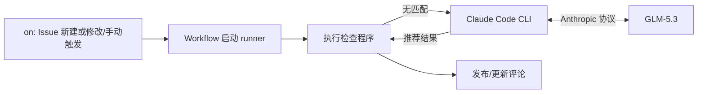

# Issue 治理 Agent（AtomGit）

## 1. 功能

当前实现 issue 模板检查功能：**Issue 触发 → 读取标题、正文和模板 → 检查 → 生成结果 → 评论反馈**。

输入：issue新建/修改标题或描述；人为触发workflow

输出：

- **完全匹配模板**：反馈“基础格式检查通过”，并列出匹配的模板。
- **部分匹配模板**：标题前缀或正文章节与模板匹配，但格式尚不完整；仅展示匹配模板的问题，提示作者补齐缺失章节、填写必填内容或修正标题前缀。
- **完全不匹配模板**：由 Agent 根据 Issue 内容推荐模板并说明理由；未能推荐时，展示各模板的格式要求，供作者选择。

## 2. 工作流程

```text
新建 / 修改 Issue，或手动指定编号
  → Workflow 获取本仓代码和模板，准备 Python、依赖及固定版本的 Claude Code CLI
  → main() 读取配置、加载本地模板
  → 读取 Issue 最新标题和正文
  →  check_issue(title, body, templates) 执行基础格式检查
      → 完全匹配：反馈通过
      → 部分匹配：提示需要补充或修改的内容
      → 完全不匹配：启动 claude -p，使用团队 Key 调用 GLM-5.3 推荐模板
  → format_comment() 生成评论草稿
  → 发布前确认 Issue 内容未发生变化
  → 发布或更新检查评论
  → 输出 JSON 日志与 Actions Summary
```



## 3. 使用方式

### 3.1 部署到目标仓库

以下路径均相对于 **CommunityGovAgent 或目标 AtomGit 仓库根目录**。

```text
目标仓库/
└── .gitcode/
    ├── workflows/issue-compliance.yml
    ├── ISSUE_TEMPLATE/*.yml
    └── scripts/issue_gov/
        ├── issue_checker.py
        ├── recommend_template.md
        └── requirements.txt
```

1. 将 `.gitcode/workflows/issue-compliance.yml` 和 `.gitcode/scripts/issue_gov/` 按相同路径复制到目标仓库。
2. 在 `.gitcode/ISSUE_TEMPLATE/` 放置目标仓库实际使用的模板。如果模板目录不同，修改工作流中的 `TEMPLATE_DIR`。
3. 开启仓库的 AtomGit Action，并确保有可用执行机；必要时根据仓库配置调整工作流的 `runs-on`。
4. 将工作流、脚本和模板提交到默认分支。

当前检查器支持 YAML 模板中的单行输入 `input`、多行输入 `textarea` 和说明文字 `markdown`；不支持 Markdown 文件模板、下拉框或复选框等其他组件。模板应包含可检查的文本输入字段。

### 3.2 配置模板推荐

在仓库流水线的密钥与变量设置中配置：

| 配置项 | 类型 | 是否必填 | 说明 |
| --- | --- | --- | --- |
| `GLM_CODING_API_KEY` | Secret（密钥） | 是 | 团队 GLM Coding Plan Key；不配置仍可检查基础格式 |
| `LLM_MODEL` | Variable（变量） | 否 | 推荐模型名称，默认 `glm-5.3` |

工作流自动准备 Python、Node.js、检查依赖和 Claude Code，无需手动安装或登录。平台访问令牌、当前仓库和自动触发的 Issue 编号由工作流提供，无需额外设置评论账号或用户 ID。

### 3.3 自动检查

工作流已配置在 Issue 新建，以及标题或正文修改后运行。部署后，新建一个测试 Issue，再修改标题或正文，分别检查流水线是否启动、是否收到检查评论。

### 3.4 手动检查

1. 进入仓库流水线页面，选择 **Issue 规范性检测**。
2. 选择手动运行，填写 `issue_number`。
3. 输入本仓库的正整数 Issue 编号，例如 `12`，不带 `#`，不填写完整网址或 Pull Request 编号。
4. 运行后查看 Issue 评论，以及流水线日志和运行摘要。

自动和手动运行都会直接发布或更新检查评论。

### 3.5 查看结果与处理问题

- **检查通过**：无需修改模板格式。
- **部分匹配**：按评论提示补齐内容，再编辑 Issue 或手动补跑。
- **推荐了模板**：参考推荐模板调整标题和正文；推荐不代表已经通过格式检查。
- **推荐不可用**：检查模型密钥配置和流水线提示，也可以根据评论列出的格式要求手动选择模板。
- **工作流运行失败**：查看失败步骤的日志，检查模板、执行机和仓库权限，处理后重新运行。

## 4. 验证

在目标仓库根目录执行离线测试：

```bash
python3 -B -m unittest discover -s .gitcode/scripts/issue_gov/tests -v
```

现有测试主要覆盖 AtomGit 适配与部分主流程，使用模拟响应，不访问真实模型或发布评论。部署后仍需验证自动触发、首次发表评论及编辑后更新评论。
