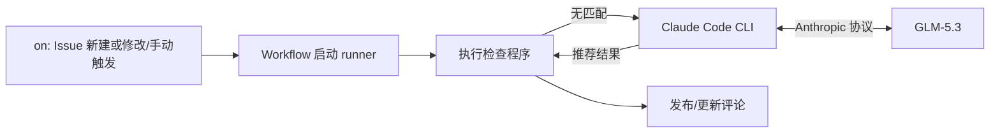

# Issue 治理 Agent

## 1. 目标

当前实现 issue 模板检查功能：**Issue 触发 → 读取标题、正文和模板 → 检查 → 生成结果 → 评论反馈**。

输入：issue新建/修改标题或描述；人为触发workflow

输出：

- **完全匹配模板**：反馈“基础格式检查通过”，并列出匹配的模板。
- **部分匹配模板**：标题前缀或正文章节与模板匹配，但格式尚不完整；仅展示匹配模板的问题，提示作者补齐缺失章节、填写必填内容或修正标题前缀。
- **完全不匹配模板**：由 Agent 根据 Issue 内容推荐模板并说明理由；未能推荐时，展示各模板的格式要求，供作者选择。

## 2. 执行流程

```text
新建 / 修改 Issue，或手动指定编号
  → Workflow 获取本仓代码和模板，准备 Python、依赖及固定版本的 Claude Code CLI
  → main() 读取配置、加载本地模板
  → GitHub API 获取 Issue 最新标题和原始 Markdown 正文
  → check_issue(title, body, templates) 执行基础格式检查
  → 无匹配：启动 claude -p，使用团队 Key 调用 GLM-5.3 推荐模板
  → 读取模型回答，检查模板名和推荐理由格式；结果无效则保留格式反馈
  → format_comment() 生成评论草稿
  → 发布前复查 Issue 后新建 / 更新评论
  → 输出 JSON 日志与 Actions Summary
```



检查程序和 Claude Code 直接在 runner 中运行，任务完成后退出。Agent 仅负责推荐模板，生成并发布评论由普通程序进行。

## 3. 使用方式

在仓库 Settings → Secrets and variables → Actions 中添加 Secret `GLM_CODING_API_KEY`，值为团队 Coding Plan Key。可选添加变量 `LLM_MODEL` 覆盖默认 `glm-5.3`。

Workflow 在同一 job 中获取代码，准备 Python、Node.js 22，安装 Python 依赖和 `@anthropic-ai/claude-code@2.1.316`，再运行检查程序。CLI 使用团队 Key 鉴权，接入地址为 `https://open.bigmodel.cn/api/anthropic`，无需手动登录。

新建或修改 Issue 自动检查并发布评论。手动运行时，在 Actions → Issue 规范性检测 → Run workflow 填写本仓 Issue 编号，运行后直接发布或更新评论。

| 环境变量 | 用途 |
| --- | --- |
| `GH_TOKEN` | 工作流通过 `secrets.GITHUB_TOKEN` 注入，用于读取 Issue 和写评论 |
| `AGENT_API_KEY` | workflow 从 Secret `GLM_CODING_API_KEY` 注入的团队 Key；仅无匹配时使用，未设置则不启动 CLI |
| `LLM_MODEL` | 模型名；默认 `glm-5.3` |
| `REPOSITORY` | 当前仓库，格式为 `owner/repo` |
| `ISSUE_NUMBER` | 正整数 Issue 编号，不接受 Pull Request |
| `TEMPLATE_DIR` | 本地模板目录；默认定位仓库的 `.github/ISSUE_TEMPLATE`，显式相对路径以当前工作目录为基准 |
| `GITHUB_STEP_SUMMARY` | Actions 提供的摘要文件路径；未设置时只输出日志 |

## 4. 测试

在 `.github/scripts/issue_gov/` 目录执行：

```bash
python3 -m unittest discover -s tests -v
```