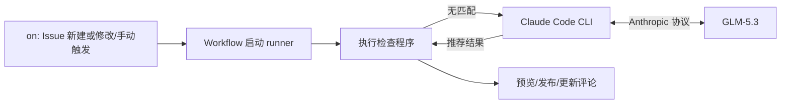

# Issue 模板检查与推荐

检查 GitHub Issue 的标题前缀、必填章节及填写内容，并自动发布或更新检查评论。满足任一现有模板即通过；完全没有模板匹配痕迹时，由模型根据内容推荐模板。部分匹配或完全匹配时不调用模型。不判断信息是否充分或 bug 是否真实，也不推断用户提交时是否选择过模板。

## 1. 执行流程

```text
新建 / 修改 Issue，或手动指定编号
  → Workflow 获取本仓代码和模板，准备 Python、依赖及固定版本的 Claude Code CLI
  → main() 读取配置、加载本地模板
  → GitHub API 获取 Issue 最新标题和原始 Markdown 正文
  → check_issue(title, body, templates) 执行基础格式检查
  → 无匹配：启动 claude -p，使用团队 Key 调用 GLM-5.3 推荐模板
  → 读取模型回答，检查模板名和推荐理由格式；结果无效则保留格式反馈
  → format_comment() 生成评论草稿
  → 预览，或发布前复查 Issue 后新建 / 更新评论
  → 输出 JSON 日志与 Actions Summary
```



检查程序和 Claude Code 直接在 runner 中运行，任务完成后退出。Agent 仅负责推荐模板，生成并发布评论由普通程序进行。

## 2. 具体实现

以下文件路径相对于仓库根目录。

| 文件 | 职责 |
| --- | --- |
| `.github/workflows/issue-compliance.yml` | 配置触发事件、权限、并发组和参数；安装固定版本 Claude Code 并注入团队 Key |
| `issueGovAgent/prompts/recommend_template.md` | 模板推荐提示词与输出要求 |
| `issueGovAgent/src/issue_checker.py` | 模板加载、格式检查、推荐模板、GitHub 请求及评论；通过 CLI 子进程调用 Agent |

### 2.1 模板匹配检查

#### 2.1.1 模板与 Issue 读取

`load_templates()` 解析 YAML；`_fields()` 提取模板字典中的输入字段，保留字段名称、必填标记、占位提示等规则。
`_sections()` 解析 Issue 的 Markdown 正文；Issue 标题由 `check_issue()` 单独检查。

具体规则如下：

- 当前章节到下一个同级或更高级标题为止；子节正文计入父节，子节也单独生成一项。
- 去掉子标题文字和普通 HTML 注释，避免“只有小标题、没有正文”被判为已填写。
- 代码块、引用中的伪标题不作为章节；代码块正文保留，代码里的 HTML 注释也作为字面内容保留。
- 同名章节内容合并；输出为平铺字典，不保留章节树。

例如 `## 缺陷反馈` 下有 `### 问题描述`，其正文为“启动失败。”，则两个章节的校验内容都是“启动失败。”；若只有这两个标题，则两项内容都为空。

#### 2.1.2 检查规则

遍历所有模板，对每个模板独立收集问题：

| 判断 | 处理 |
| --- | --- |
| 标题不以模板 `title` 开头 | 记录 `title_prefix`，继续检查正文；前缀中的空格参与匹配 |
| 字段非必填，或未配置 `required` | 跳过该字段 |
| 必填字段的 `label` 不在章节映射中 | 记录 `missing_section`，跳过该字段的空内容检查 |
| 章节内容为空，或完全等于 `_No response_`、`No response`、模板 `placeholder` | 记录 `empty_section` |
| 章节有其他内容 | 该字段通过，不判断语义或信息充分性 |

没有模板、模板没有文本字段或包含不支持的字段类型时抛出异常，不当作 Issue 格式不合格。

返回结构：

```python
{
    "status": "pass",  # pass/partial_match/no_match
    "matched_templates": ["缺陷反馈"],
    "checks": [
        {"template": "缺陷反馈", "problems": []},
        {"template": "功能建议", "problems": [
            {"field": "title", "reason": "title_prefix", "message": "标题应以……开头"}
        ]}
    ]
}
```

`checks` 保存各模板的完整问题。`matched_templates` 在 `pass` 时保存完全匹配的模板；在 `partial_match` 时保存待展示问题的模板，标题前缀匹配优先，否则采用正文同名章节对应的模板；在 `no_match` 时为空。

### 2.2 无匹配时推荐模板

仅 `status=no_match` 时调用 `recommend_template()`，通过 Claude Code CLI 使用 GLM Coding Plan 推荐模板；完全匹配和部分匹配沿用格式检查结果。

调用过程：

- 启动 `claude -p`，默认模型为 `glm-5.3`，禁用工具调用。
- 通过 `--system-prompt` 传入 `issueGovAgent/prompts/recommend_template.md` 的内容；Issue 标题、正文和候选模板以 JSON 写入标准输入。
- 使用临时工作和配置目录，最多 3 轮、总超时 120 秒；结束后清理进程和目录。

程序读取 CLI 的 `result`，校验模板名属于候选集合或为 `null`、理由为 1～500 字符。推荐结果存入 `result.recommendation`，不改变格式检查结果：

```json
{
  "status": "recommended",
  "template": "Documentation|文档反馈",
  "reason": "主要诉求是修正文档引用。"
}
```

| 推荐结果 | 处理 |
| --- | --- |
| `recommended` | 展示推荐模板和理由 |
| `uncertain` | 无法确定模板，`template=null`，保留格式反馈 |
| `unavailable` | 未配置 Key、调用失败或输出无效，展示提示并保留格式反馈 |

### 2.3 评论与运行行为

#### 2.3.1 评论内容

| 检查结果 | 评论内容 |
| --- | --- |
| `pass` | 基础格式通过，列出匹配模板；不展示其他模板的问题 |
| `partial_match`，标题前缀符合 | 仅展示这些模板的问题 |
| `partial_match`，仅正文章节符合 | 仅展示含这些同名字段章节的模板问题；可对应多个模板 |
| `no_match`，模型成功推荐模板 | 展示推荐模板和理由 |
| `no_match`，没有成功推荐 | 展示全部模板的问题，供作者选择 |

需要展示格式问题时，将相关模板的问题放在可展开的折叠区内，逐条列出字段及问题说明，并附模板选择页面链接。

#### 2.3.2 评论行为

只有作者登录名为 `github-actions[bot]`、类型为 `Bot`，且正文以 `<!-- issue-gov-agent -->` 标记开头的评论，才作为本工具评论处理。

- 同一机器人发布的其他 workflow 评论，只要没有该标记，就不会被覆盖；若不同 workflow 需要各自维护独立评论，必须使用不同标记。
- 每页读取最多 100 条评论。找到目标后，正文相同返回 `unchanged`；正文不同则按评论 ID 发起 `PATCH` 替换正文，返回 `updated`。
- 当前页不足 100 条表示查找到末页；满 100 条则继续下一页。全部页面都未找到目标时，`POST` 新建评论并返回 `created`。
- 当前 workflow 按仓库和 Issue 编号设置并发组、串行执行，减少重复创建；不订阅评论事件，避免反馈触发检查循环。

#### 2.3.3 预览、发布与异常

自动新建 / 编辑事件会发布评论；手动触发默认仅预览，勾选发布选项后才写入 Issue。预览也会生成结果和评论草稿，`comment_action` 为 `preview`。

发布前再次读取 Issue，若标题或正文已变化，返回 `skipped_changed`，本轮不发布旧结论。自动流程由后续编辑事件重新检查；脱离自动触发独立运行时，需要调用方再次执行。这是发布前复查，不是原子更新。

运行日志输出 `result`、`comment_action` 和 `comment_body`。设置了 `GITHUB_STEP_SUMMARY` 时，还会写入该路径供 Actions 摘要展示；预览日志和摘要不是 Issue 评论。

推荐失败的提示写入 Actions 警告、运行摘要和评论；展示前隐藏 Key、合并换行并截取前 500 字符。

`partial_match` 和 `no_match` 都是正常检查结果。接口失败或模板异常直接作为运行错误处理，不发布“违规”结论；发布接口失败则本轮运行报错。

### 2.4 具体实现函数

以下函数均位于 `issueGovAgent/src/issue_checker.py`。

| 函数 | 职责 |
| --- | --- |
| `main()` | 读取配置，串联模板加载、Issue 获取、检查、评论和日志 |
| `load_templates(directory)` | 将 `.yml` / `.yaml` 模板解析为字典，跳过 `config.yml` / `config.yaml` |
| `_fields(template)` | 从模板字典中提取字段，忽略说明性 `markdown` 组件；仅支持 `input`、`textarea` |
| `_sections(body)` | 将 Markdown 正文提取为“章节标题 → 用于校验的内容” |
| `check_issue(title, body, templates)` | 不访问网络，仅对输入数据进行格式检查，返回结论及各模板的问题 |
| `recommend_template(title, body, templates, agent_api_key, model)` | 启动 Claude Code，读取并校验推荐结果；失败则保留格式结果 |
| `format_comment(result, repository)` | 根据结果生成评论文本，不发送请求 |
| `github_request(method, path, gh_token, data=None)` | 使用显式传入的 Token 调用 GitHub API |
| `update_comment(repository, number, body, gh_token)` | 查找本工具评论，执行新建、更新或跳过 |

`GH_TOKEN` 在 `main()` 中读取后显式传入请求和评论函数。网站和 API 地址使用文件顶部的 `GITHUB_WEB_URL`、`GITHUB_API_URL` 常量，不再提供 `SERVER_URL`、`API_URL` 环境配置。

## 3. 使用方式

### 3.1 GitHub Actions

将 `CommunityGovAgent` 目录内容作为目标 GitHub 仓库根目录提交到默认分支，并启用 Actions。工作流需要 `contents: read`、`issues: write` 权限，组织策略也需允许。

在仓库 Settings → Secrets and variables → Actions 中添加 Secret `GLM_CODING_API_KEY`，值为团队 Coding Plan Key。可选添加变量 `LLM_MODEL` 覆盖默认 `glm-5.3`。Key 与 `GITHUB_TOKEN` 分开配置，不写入代码。未配置 Key 时仍可执行格式检查。

Workflow 在同一 job 中获取代码，准备 Python、Node.js 22，安装 Python 依赖和 `@anthropic-ai/claude-code@2.1.316`，再运行检查程序。CLI 使用团队 Key 鉴权，接入地址为 `https://open.bigmodel.cn/api/anthropic`，无需手动登录。

新建或修改 Issue 自动检查并发布评论。手动运行时，在 Actions → Issue 规范性检测 → Run workflow 填写本仓 Issue 编号；默认仅预览，勾选 `post_comment` 后发布。

| 环境变量 | 用途 |
| --- | --- |
| `GH_TOKEN` | 工作流通过 `secrets.GITHUB_TOKEN` 注入，用于读取 Issue 和写评论 |
| `AGENT_API_KEY` | workflow 从 Secret `GLM_CODING_API_KEY` 注入的团队 Key；仅无匹配时使用，未设置则不启动 CLI |
| `LLM_MODEL` | 模型名；默认 `glm-5.3` |
| `REPOSITORY` | 当前仓库，格式为 `owner/repo` |
| `ISSUE_NUMBER` | 正整数 Issue 编号，不接受 Pull Request |
| `TEMPLATE_DIR` | 本地模板目录；相对于模块工作目录默认为 `../.github/ISSUE_TEMPLATE` |
| `POST_COMMENT` | `true` 时发布，其他值或未设置时仅预览 |
| `GITHUB_STEP_SUMMARY` | Actions 提供的摘要文件路径；未设置时只输出日志 |

### 3.2 本地检查

在 `issueGovAgent/` 目录安装依赖（Python 3.10+）：

```bash
python3 -m pip install -r requirements.txt
```

仅调用 `check_issue()` 时无需网络或平台凭据，也不会执行模型推荐：

```python
from src.issue_checker import check_issue, load_templates

templates = load_templates("../.github/ISSUE_TEMPLATE")
result = check_issue(
    title="[Question|问题咨询]: 如何构建？",
    body="### Describe the question / 问题描述 (Mandatory / 必填)\n如何构建？",
    templates=templates,
)
print(result)
```

本地需要模型推荐时，还需 Linux、Node.js 22+，并先安装 CLI：

```bash
npm install -g @anthropic-ai/claude-code@2.1.316
claude --version
```

本地设置环境变量 `AGENT_API_KEY` 后再运行程序。仅做本地格式检查或运行测试无需安装 CLI。

手动预览也会在无匹配时调用模型，但不会写入 Issue 评论。

需要读取真实 Issue 时，设置上表中的运行参数后执行 `python3 src/issue_checker.py`。

### 3.3 平台适配

`check_issue()` 不依赖平台或 Token，可以复用；`main()` 串联了 GitHub 专用操作。接入 AtomGit 时，需要适配工作流事件、认证、API 路径与响应、机器人身份、模板路径及网页链接。若选择由 AtomGit 调用外部服务，还需新增 HTTP 入口；可复用的是检查逻辑。

## 4. 测试

在 `issueGovAgent/` 目录执行：

```bash
python3 -m unittest discover -s tests -v
```

| 测试文件 | 覆盖内容 |
| --- | --- |
| `tests/test_template_checker.py` | 模板加载、字段规则、Markdown 章节和检查结果 |
| `tests/test_comments.py` | 通过 / 失败评论、候选模板筛选、问题展示 |
| `tests/test_llm_recommendation.py` | 推荐触发边界、CLI 参数与输出、凭证隔离、真实子进程和超时清理、推荐评论 |
| `tests/test_github_workflow.py` | 请求认证、评论归属与分页、新建 / 更新 / 跳过、预览、发布前复查、异常和摘要 |

测试使用模拟响应和本地替身进程，不访问真实模型或发布评论。真实 Claude Code 2.1.316 已通过本机模拟 Anthropic 接口验证；真实 Actions 权限和 GLM 分类效果仍需配置凭据后验证。

接口参考：[智谱 Claude Code 接入](https://docs.bigmodel.cn/cn/coding-plan/tool/claude)、[Claude Code 非交互运行](https://code.claude.com/docs/en/headless)。
